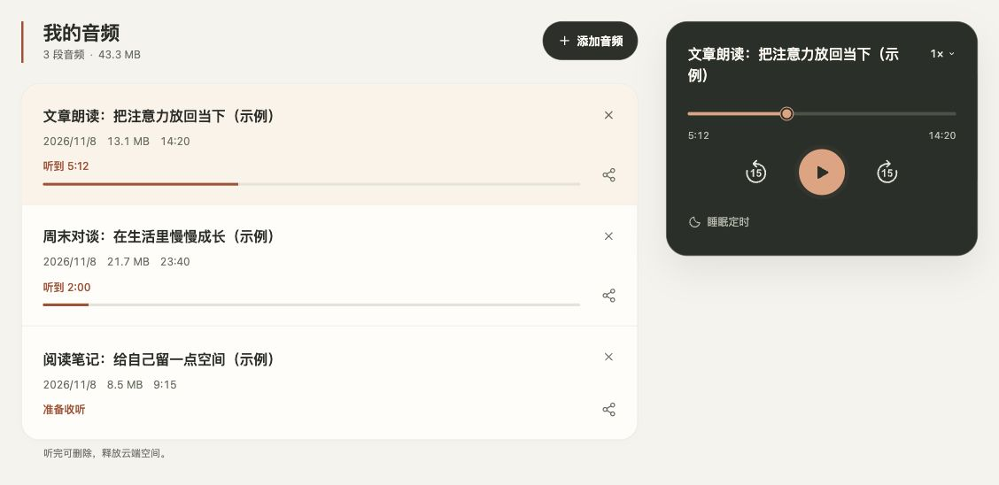
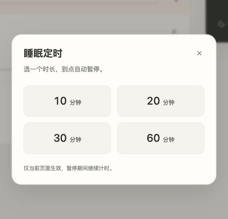
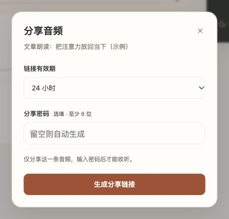

# JTG Audio

**把电脑上的音频，变成手机里随时可以接着听的私人音频库。**

这是我为日常文稿、访谈和长音频回听做的小工具。上传一次，电脑和手机共用播放进度；需要分享时，可以只分享其中一条音频。这里分享的是程序代码，你可以部署自己的音频库。

## 界面预览

以下是当前版本在本机运行的真实界面，音频标题和进度均为示例内容。点击图片可查看大图。



**音频库与续听播放器**：左侧查看音频、时长和已听进度，右侧继续播放、调整倍速或设置睡眠定时。

| 睡眠定时 | 单条音频分享 |
| --- | --- |
|  |  |
| 选择时长，到点暂停；仅对当前页面生效。 | 设置链接有效期和独立密码，只分享选中的一条音频。 |

## 适合什么场景

- 在电脑上整理音频，在手机上分几次听完。
- 保存自己有权使用的讲稿、访谈、课程或文章朗读音频。
- 偶尔将一条音频分享给朋友，同时保留私人库的访问边界。

## 目前能做什么

| 功能 | 使用方式 |
| --- | --- |
| 上传与管理 | 上传常见音频，查看列表和占用空间，删除不再需要的内容 |
| 日常播放 | 播放、暂停、拖动进度、前后跳转 15 秒、倍速收听 |
| 跨设备续听 | 私人库的设备共享同一条音频的进度，新设备接手后避免旧设备覆盖 |
| 记住登录 | 可记住当前设备 30 天，也可选择临时登录 |
| 睡眠定时 | 10、20、30、60 分钟后暂停，可修改或取消 |
| 单条分享 | 独立密码、24 小时或 7 天有效期，支持随时撤销 |
| 手机使用 | 适配窄屏、长标题和上传窗口 |

分享访客只能访问被分享的音频，不能查看整个库、上传或删除；访客的播放进度保存在自己的浏览器里，不影响库主人的续听位置。

## 在本机试用

需要 **Node.js 22.5 或更新版本**。

```bash
git clone https://github.com/eryiyao/jtg-audio.git
cd jtg-audio
npm ci
npm start
```

浏览器打开 <http://127.0.0.1:3000>。本地默认仅监听本机且免登录；公开部署时需配置 HTTPS 和访问密码，见[自行部署与维护](docs/deployment.md)。

支持 mp3、m4a、mp4、wav、ogg、opus、aac、flac、webm，实际播放能力取决于浏览器编码支持；默认单个文件上限 200 MB。Node 的 SQLite 实验性提示不影响启动。

## 数据放在哪里

| 路径 | 内容 |
| --- | --- |
| `data/jtg.sqlite` | 音频信息、库主人的播放进度、登录与分享记录 |
| `uploads/` | 上传的音频文件 |
| `src/` | 服务和数据库代码 |
| `public/` | 网页界面 |
| `test/` | 接口测试 |

数据库和上传文件不进入 Git。备份时请同时保存它们；删除音频会删除实际文件，目前没有回收站。仓库不包含作者的音频或登录凭据。

## 当前边界

- 面向个人使用，没有多用户注册、成员权限或每人独立的私人库进度。
- 刷新或换设备后需要点击播放，浏览器不会自动开始播放。
- 睡眠定时仅对当前页面生效，手机锁屏和长时间后台运行的准确性仍需真机验证。
- 分享过期和撤销可以限制后续访问，但不能阻止访客录音或保存已收到的内容。
- 这是持续迭代的个人工具；使用自己的重要音频前，请建立备份。

## 文档与开发

- [使用细节与接口](docs/usage.md)
- [环境变量](docs/configuration.md)：`.env` 不会自动加载，需要导出或通过进程管理器注入。
- [自行部署与维护](docs/deployment.md)

技术栈：Node.js 内置 SQLite、Express、原生 HTML / CSS / JavaScript。

```bash
npm test
```

欢迎通过 [Issues](https://github.com/eryiyao/jtg-audio/issues) 反馈问题。更多小工具见 [Jim To Grow · 工具](https://jimtogrow.com/tools/)。

说明更新：2026-11-08，包含跨设备续听、睡眠定时与单条密码分享。
